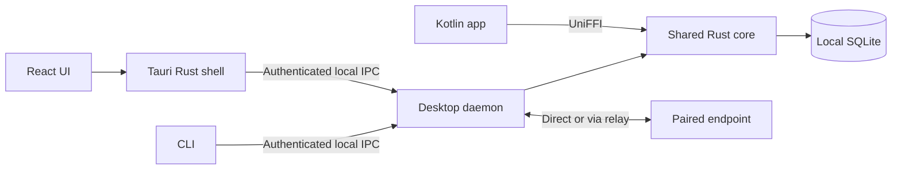

# Lyteboard architecture

## Process ownership

On Linux, one per-user daemon owns service state. The CLI and the native Rust side of the Tauri GUI use the same authenticated local IPC client. React calls a narrow, read-only Tauri status command. The daemon will also own device connections, pairing state, history, and background work as those features arrive. Windows will use the same process ownership model when its IPC transport is implemented. [Linux daemon and IPC](daemon.md)

On Android, the Kotlin app owns the platform lifecycle and clipboard adapter. It will call the same Rust core in-process through a small UniFFI surface. Its foreground clipboard actions follow Android's focus rules. See [Platform constraints](platforms.md).

The separate relay process will forward opaque, end-to-end encrypted messages when direct LAN transport is unavailable. Its Phase 1 binary exposes a local health endpoint. The diagram shows the intended data paths.

## Code boundaries

| Boundary | Responsibility |
| --- | --- |
| Protocol (`crates/protocol`) | Versioned IPC messages and peer wire messages. They will have independent compatibility rules, bounded framing, and explicit operation errors. |
| Encryption and pairing (`crates/core`) | Library-backed authenticated key exchange, device identity, single-use and expiring QR enrollment, and end-to-end session protection. |
| Device management (`crates/core`) | Trusted device records, per-device configuration, and unpairing. |
| Networking | The endpoint selects direct LAN transport before the encrypted relay. `services/relay` owns network forwarding and its own limits. |
| Synchronization (`crates/core`) | Explicit selection of recipients, opt-in automatic capture, reconnect backoff, duplicate suppression, and clipboard loop prevention. |
| Clipboard adapters | Linux X11 and Wayland, Windows, and Android provide platform-specific clipboard operations. Capabilities can differ between sessions. |
| Storage | One local SQLite database per endpoint for history and configuration. The desktop daemon is the sole owner of that database. Device private keys belong in OS-protected credential storage. |
| User interfaces (`apps/`) | CLI and GUI present status and request operations from the daemon. Kotlin presents Android actions and passes input through the FFI boundary. |

Phase 1.5 implements the Linux local IPC path from both clients. The peer network and clipboard paths remain planned.

## Trust and privacy

- Linux uses a pathname socket in a private user runtime directory and checks kernel peer credentials in both directions. The planned Windows transport uses a local-only named pipe with access restricted to the logon identity. Authentication is at the OS-user boundary, so software acting as that user shares its access. [Linux daemon and IPC](daemon.md#protocol-and-trust-boundary)
- Pairing should bind the displayed QR and one-time enrollment to the expected device identity before persisting trust. Use an established protocol and implementation, and review the handshake and key storage before adding remote transport. A Noise implementation such as Snow is a candidate. [Noise framework](https://noiseprotocol.org/noise.html), [Snow](https://docs.rs/snow/0.10.0/snow/)
- Direct LAN peers and the relay transport carry the same encrypted payload. Authentication, replay protection, and bounds on messages, queues, and concurrent connections are required before forwarding is enabled. The relay can observe connection metadata such as IP addresses, timing, and message sizes. [Axum WebSocket API](https://docs.rs/axum/latest/axum/extract/ws/)
- Manual sharing is the default. Capture clipboard contents after an explicit action, with continuous capture gated by both opt-in and platform capability. Use OS-backed key storage, user-private database files, and bounded user-controlled history retention. E2EE covers transfers. Local history still needs its own at-rest and deletion policy. [SQLite file format](https://sqlite.org/fileformat2.html)
- Logs may contain operational details such as error categories. Keep clipboard text and images, pairing tokens, and private keys out of logs. The project has no accounts or telemetry.

## Tradeoffs

One daemon gives both desktop interfaces a consistent view and keeps connection and storage ownership in one place. It adds a lifecycle and IPC boundary, so the clients need actionable errors when the daemon is unavailable. A common Rust core keeps the protocol and trust decisions consistent on Android, while the Kotlin app retains control of the mobile lifecycle.

The headless packages are Cargo's default members, so relay and CLI development can run without desktop system libraries. The workspace still includes the Tauri application and shares one dependency lock. A full workspace build requires native desktop prerequisites.

Prefer event-driven clipboard notifications where supported, idle waits, and bounded queues. Wayland background capabilities and Android focus rules can reduce what automatic sync can offer. Keep explicit actions available when the platform allows them.

