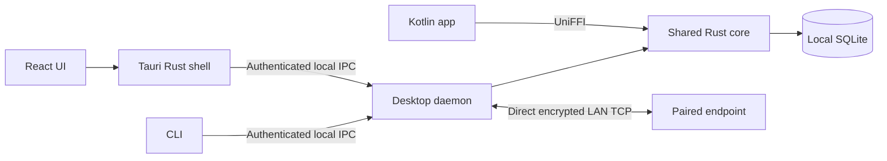

# Lyteboard architecture

## Process ownership

On Linux, one per-user daemon owns service state. The CLI and the native Rust side of the Tauri GUI use the same authenticated local IPC client. React calls a narrow, read-only Tauri status command. The daemon will also own device connections, pairing state, history, and background work as those features arrive. Windows will use the same process ownership model when its IPC transport is implemented. [Linux daemon and IPC](daemon.md)

On Android, the Kotlin app owns the platform lifecycle and clipboard adapter. It will call the same Rust core in-process through a small UniFFI surface. Its foreground clipboard actions follow Android's focus rules. See [Platform constraints](platforms.md).

Paired devices will communicate over direct Noise-encrypted TCP on the local network. QR invitations will advertise a reachable listener. mDNS discovery and manual IP fallback are later additions. The diagram shows the intended data paths.

## Code boundaries

| Boundary | Responsibility |
| --- | --- |
| Protocol (`crates/protocol`) | Keep verified `ipc` types and framing. Define an independent, bounded, versioned LAN peer codec. |
| Peer communication (`crates/core`) | Own device identity, pairing state, peer pins, Noise sessions, and transfer validation. Depend on transport and platform credential interfaces only as implementations arrive. |
| Device trust (`crates/core`) | Peer records, local approval, revocation, and lookup by pinned identity. The daemon owns the records on desktop. |
| Networking | Open one ordered TCP stream per peer session. Bound connection admission, frame lengths, and deadlines. |
| Synchronization (`crates/core`) | Explicit selection of recipients, opt-in automatic capture, reconnect backoff, duplicate suppression, and clipboard loop prevention. |
| Clipboard adapters | Linux X11 and Wayland, Windows, and Android provide platform-specific clipboard operations. Capabilities can differ between sessions. |
| Storage | Linux profiles keep trust metadata in a private versioned snapshot and identity seeds in Secret Service. Optional history storage and daemon ownership are planned. |
| User interfaces (`apps/`) | CLI and GUI present status and request operations from the daemon. Kotlin presents Android actions and passes input through the FFI boundary. |

Phase 2B implements in-process pairing and confirmed sessions. LAN-1 runs those state machines over direct TCP in the Rust core with in-memory trust. The daemon will own peer networking on desktop. The standalone CLI and Tauri frontend use the daemon instead of opening their own peer connections. Kotlin uses a small, typed UniFFI interface to the Rust core. Peer transport limits and trust decisions stay in Rust. [Security design](security.md), [Wire protocol](protocol.md)

## Trust and privacy

- Linux uses a pathname socket in a private user runtime directory and checks kernel peer credentials in both directions. The planned Windows transport uses a local-only named pipe with access restricted to the logon identity. Authentication is at the OS-user boundary, so software acting as that user shares its access. [Linux daemon and IPC](daemon.md#protocol-and-trust-boundary)
- Manual sharing is the default. Gate continuous capture on opt-in and platform capability. The [security design](security.md) defines device trust, revocation, and the separate requirements for history at rest.

## Tradeoffs

One daemon gives both desktop interfaces a consistent view and keeps connection and storage ownership in one place. It adds a lifecycle and IPC boundary, so the clients need actionable errors when the daemon is unavailable. A common Rust core keeps the protocol and trust decisions consistent on Android, while the Kotlin app retains control of the mobile lifecycle.

The headless packages are Cargo's default members, so CLI and daemon development can run without desktop system libraries. The workspace still includes the Tauri application and shares one dependency lock. A full workspace build requires native desktop prerequisites.

Prefer event-driven clipboard notifications where supported, idle waits, and bounded queues. Wayland background capabilities and Android focus rules can reduce what automatic sync can offer. Keep explicit actions available when the platform allows them.

## Implementation gates

| Phase | Acceptance criteria |
| --- | --- |
| **LAN-0 · Baseline** | Keep Phase 1 and 1.5 application behavior and the verified Phase 2B in-memory protocol. Remove the old service and unfinished application wiring. |
| **LAN-1 · Direct TCP** | Two independent Rust endpoints pair from a QR carrying a reachable LAN address, establish fresh pinned KK sessions, and exchange acknowledged text. Exercise wrong pins, expired and reused invitations, and malformed frames. |
| **LAN-2A · Durable identity and trust** | Store credentials in Linux Secret Service. Reload active pins, dial hints, and revocations from a private profile. Verify a fresh authenticated session after reopening it. |
| **Later · Daemon integration** | Load the durable profile from the daemon, reconnect to the saved address, and expose manual text sharing through CLI and GUI. |
| **Later · Clipboard and discovery** | Add bounded image streaming, private local history, and clipboard adapters. Add mDNS and manual IP fallback after the direct path works. |
